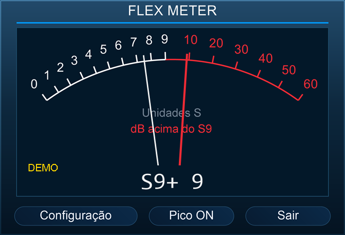

# Flex Meter

Medidor de sinal para FlexRadio, com leitura contínua e retenção de pico.

**Desenvolvido por Eduardo Arraia.**

[**Descarregar a versão mais recente para Windows**](https://github.com/CT7ASY/FlexMeter/releases/latest)

## Funcionalidades

- Ponteiro branco para leitura contínua e ponteiro encarnado para retenção de pico.
- Escala proporcional: 6 dB por unidade S e indicação numérica do pico.
- Ligação direta por IP ou por porta série do SmartSDR CAT.
- Indicativo personalizável no cabeçalho.
- Português, Espanhol e Inglês selecionáveis na Configuração.
- Janela redimensionável, proporcional e sempre à frente das outras aplicações.
- Memória da posição, do tamanho e da configuração.
- Verificação de novas versões ao abrir o programa e em **Configuração → Sobre → Verificar atualizações**.

## Instalar

1. Abre [Releases](https://github.com/CT7ASY/FlexMeter/releases/latest) e descarrega o ficheiro **Instalar-Flex-Meter-…exe**.
2. Executa o instalador. O programa fica em **`C:\CT7ASY\Flex Meter`**. Ao atualizar versões anteriores, o instalador propõe esta pasta em vez de reutilizar a localização antiga.
3. O instalador cria automaticamente o atalho **Flex Meter** no Ambiente de Trabalho.
4. Na Configuração, escolhe **Ligação por IP** e introduz o IP do rádio e a slice; ou escolhe **Porta série CAT** e seleciona uma COM dedicada do SmartSDR CAT.
5. O campo **Indicativo** é opcional. Depois de guardar, o programa liga automaticamente.

## Requisitos

- Windows 10 ou Windows 11.
- Microsoft .NET Framework 4.8 ou posterior. Se faltar, o instalador descarrega o componente oficial da Microsoft; é necessária Internet e pode ser preciso reiniciar.
- FlexRadio acessível por rede local, ou SmartSDR CAT instalado e configurado para ligação por COM.

O SmartSDR CAT é disponibilizado separadamente pela FlexRadio. O programa não cria slices nem comanda transmissão. A ligação direta por IP destina-se à rede local; não inclui SmartLink.

## Atualizações

O Flex Meter consulta a última Release estável deste repositório ao arrancar. A consulta é feita em segundo plano e uma falha de Internet não impede a utilização do medidor. Quando existe uma versão nova, podes descarregar o instalador dentro da aplicação. O Flex Meter verifica o tamanho e o SHA-256 antes de permitir a instalação e pede confirmação antes de fechar o programa. A atualização preserva as definições do utilizador.

Também podes verificar manualmente em **Configuração → Sobre → Verificar atualizações**.

## Notas

O programa e o instalador ainda não têm assinatura digital comercial. O Windows pode apresentar um aviso de reputação ou analisar o executável. O ficheiro **SHA256SUMS.txt** da Release permite conferir a integridade do download.

As definições são guardadas em `%LOCALAPPDATA%\CT7ASY\FlexMeter`. Não são incluídas nos ficheiros publicados neste repositório.

Este repositório destina-se à distribuição do instalador e da documentação. O código-fonte não está incluído nesta publicação.

## Tecnologias e créditos

C#, Windows Forms, System.Drawing e Microsoft .NET Framework. Instalador criado com [Inno Setup](https://jrsoftware.org/).

FlexRadio e SmartSDR são marcas dos respetivos titulares. Flex Meter é um programa independente, sem afiliação à FlexRadio.

